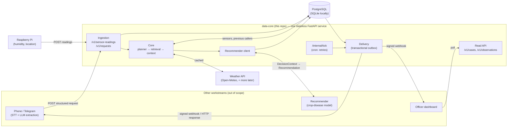
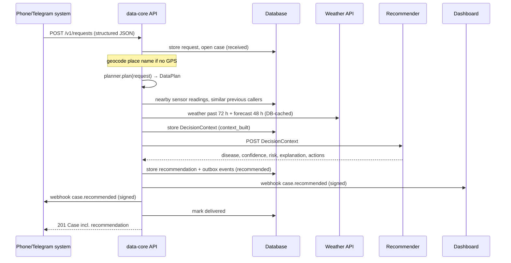

# Data-Sync & Core — Subsystem Specification

> **Status:** MVP implemented · living document · **Owner:** Data-Sync & Core workstream · **Last updated:** 2026-10-16

---

## 0. About the documents in this repository

| File | Scope | Audience |
|---|---|---|
| [`project_overview.md`](project_overview.md) | The **whole hackathon project**: the *Farmer Advisory & Early-Warning System*. It describes the end-to-end concept (farmer calls → transcription → structured report → context → recommendation → spoken answer + officer dashboard), the overall architecture, the team split and the shared API contracts. It is the shared reference for **all** workstreams. | Whole team |
| [`project.md`](project.md) (this file) | The **Data-Sync & Core subsystem only**: ingesting sensor data and caller requests, storing them, deciding *which* data a request needs, gathering it (database + weather API), handing it to the recommender, and delivering the result to the dashboard and phone system. It refines sections **3.B–3.D** of the overview (persons 2–4 in the team table). | Developers of this subsystem and the teams that integrate with it |
| [`README.md`](README.md) | How to run, test and migrate the code. | Developers |
| [`contracts/`](contracts) | Machine-readable JSON schemas and **real example payloads** for every interface. | Other workstreams |
| [`deploy/`](deploy) | Deployment guides for Azure and Vercel. | Whoever deploys |

Rule of thumb: anything about *how the parts fit together* belongs in `project_overview.md`. Anything about *how this subsystem works or what its interfaces look like* belongs here. If the two disagree, the overview wins for cross-team contracts and this file gets updated.

---

## 1. Purpose and scope

### 1.1 In scope
1. **Ingestion:** REST endpoints that receive
   - structured caller requests (JSON from the phone/Telegram workstream), and
   - sensor readings that the **Raspberry Pi pushes** (humidity, temperature, location, …).

   Both are stored in the database.
2. **Database:** sensors and readings, all previous caller requests with their location, decision contexts, recommendations, delivery state, and a weather cache.
3. **Core:** decides which data a request needs (the *data plan*), then gathers it:
   - nearby sensor readings and similar previous callers from the DB,
   - weather from the **weather API** (Open-Meteo; more APIs can be plugged in).

   It assembles all of this into a **DecisionContext**.
4. **Recommender round-trip:** sends the DecisionContext to the external recommender (crop-disease prediction, explanation, recommended actions) and stores the answer.
5. **Delivery:** pushes the result to the **dashboard** and back to the **phone system** (signed webhooks, retried until delivered). It also exposes read endpoints the dashboard can poll.

### 1.2 Out of scope
- Telephony, speech-to-text/text-to-speech, Telegram bots, and the LLM extraction that produces the structured request.
- The recommendation model itself. We feed it and consume its answer; `mocks/mock_recommender.py` is only a stand-in.
- The dashboard UI. We push events to it and offer read APIs.

---

## 2. Architecture



### 2.1 Key design decisions

| # | Decision | Why |
|---|---|---|
| 1 | **One stateless FastAPI service. No in-process background workers.** All state is in the DB. | The same code runs in Docker, on Azure Container Apps/App Service, and as a Vercel serverless function. |
| 2 | **Sensors push** (`POST /v1/sensor-readings`) instead of us polling the Pi. | The Pi is often behind NAT or on mobile networks and can't be reached from outside. Push also works serverless. Ingestion is idempotent, so the Pi can resend safely. |
| 3 | **Synchronous pipeline per request** with state stored after every step (`received → context_built → recommended → delivered`). | The caller is still on the line, so the answer comes back in the HTTP response. If a step fails, the case can be resumed from its last good state with no queue required. |
| 4 | **Transactional outbox** for webhooks, retried by `/internal/tick` with exponential backoff. | A short dashboard or phone-system outage never loses a result. |
| 5 | **Weather cache in the DB** (~1 km grid, TTL 15 min) plus retry on 5xx/429. | Fewer API calls and faster answers. Unlike an in-memory cache, it also works across serverless instances. |
| 6 | **Graceful degradation:** a failing optional source becomes a `gap` in the context and the pipeline continues. | A degraded answer beats no answer for a farmer on the phone. Verified live: an Open-Meteo 503 led to a recorded gap and the result was still delivered. |
| 7 | **Postgres** (SQLAlchemy 2 + Alembic). Spatial search = bounding-box SQL prefilter + Haversine in Python. | Portable across Azure PG Flexible Server, Neon/Supabase (Vercel) and SQLite. No PostGIS needed. *The overview suggests Azure SQL; Postgres was chosen for portability (see §9).* |
| 8 | **Pluggable components**, all selected by env vars: planner, weather provider, recommender (HTTP/mock), geocoder. | Mocks and real systems are interchangeable, so every team can work in parallel. |
| 9 | **API keys per client role** (`pi`, `input`, `dashboard`, `internal`) via `X-API-Key` or `Authorization: Bearer`. Outgoing webhooks are HMAC-SHA256-signed. | Simple, works with Vercel Cron, and receivers can verify where a webhook came from. |
| 10 | **Tolerant input adapter.** Aliases like `description`, `latitude` and `source` are mapped; unknown fields are kept in `extra`. | The final input layout is not decided. Format changes then touch one file (`input/adapters.py`), not the core. |

### 2.2 Code layout

```text
src/data_core/
  main.py, asgi.py          app factory / ASGI entrypoint
  config.py                 all settings (env vars, 12-factor)
  services.py               wires planner, weather, recommender, geocoder from settings
  db/                       SQLAlchemy models + engine/session        (alembic/ = migrations)
  schemas/                  pydantic contracts: sensors, requests, context, recommendation, cases, webhooks
  input/adapters.py         tolerant mapping of the (not yet final) caller-request layout
  ingestion/                sensor + request persistence (idempotent, geocoding of place names)
  providers/                weather (Open-Meteo, mock, DB cache) and geocoding (Open-Meteo)
  core/planner.py           DataNeedsPlanner interface + `fetch_all` baseline   ← decision logic TBD
  core/retrieval.py         nearby sensor aggregates, similar previous caller reports
  core/context.py           executes the DataPlan → DecisionContext (gaps, warnings)
  core/pipeline.py          case state machine, resume/retry
  recommender/              HTTP client + mock
  delivery/outbox.py        webhooks with HMAC signature, backoff, delivery status
  api/                      REST routers + auth
mocks/                      mock recommender, mock webhook receiver, Raspberry Pi simulator
contracts/                  JSON schemas (scripts/export_schemas.py) + real example payloads
tests/                      API, pipeline, weather and adapter tests (SQLite + respx)
deploy/                     Azure and Vercel guides;  Dockerfile, docker-compose.yml, vercel.json
```

---

## 3. Data flow of one caller request



If the recommender fails, the case ends in `failed_recommend`: the request returns `202`, and the case is resumed by `/internal/tick` or `POST /v1/cases/{id}/retry`. If a webhook fails, the event stays `pending` and the tick retries it.

---

## 4. Ingestion

### 4.1 Sensor data (Raspberry Pi → us)
`POST /v1/sensor-readings` (role `pi`) accepts a single reading or `{"readings": [...]}` (max 1000):

```json
{ "sensor_id": "pi-field-01", "recorded_at": "2026-10-16T14:00:00Z",
  "lat": -1.175, "lon": 36.836, "metrics": { "humidity_pct": 87.5, "temperature_c": 22.4 } }
```

- One row per metric (`sensor_readings`). It is idempotent on `(sensor_id, recorded_at, metric)`, so duplicates are counted, not stored.
- Unknown sensors are **auto-registered**, and the latest position is kept, so a new Pi needs no setup step. `POST /v1/sensors` optionally adds a name, kind and metadata.
- Units are inferred from the metric suffix (`_pct`→%, `_c`→°C, `_mm`→mm, …) or given explicitly in `units`.
- `quality`: `ok | suspect | mocked`. Mocked data is flagged in every context that uses it.

### 4.2 Caller requests (phone/Telegram system → us)
`POST /v1/requests` (role `input`). **The final layout is still open**, so the input is deliberately tolerant:

| Accepted | Mapped to |
|---|---|
| `text` / `description` / `transcript` / `message` / `summary` | `text` (required) |
| `lat`,`lon` / `latitude`,`longitude` / nested `location{}` | `location.lat/lon` |
| `village` / `place` / `location: "Kiambu"` | `location.name` → geocoded if no coordinates |
| `source` → `channel`, `reported_at` → `received_at`, `id`/`call_id` → `external_id`, … | see `input/adapters.py` |
| anything else | kept in `extra` (stored, never rejected) |

- `external_id` is an **idempotency key**: sending the same request twice returns the existing case (`200`).
- `callback_url` (optional) overrides where the phone-system webhook goes.
- `problem_type` and `crop` are normalised (`"Crop Health"` → `crop_health`), so similar reports match.

---

## 5. The core

### 5.1 Deciding which data is needed — ⚠️ still open

> **How exactly the core decides which data is needed for the recommendation system is currently still unknown.** It depends on which inputs the recommender team's model needs. This is not specified yet.

What is fixed is the **interface** (`core/planner.py`):

```python
class DataNeedsPlanner(Protocol):
    name: str
    def plan(self, request: CallerRequest) -> DataPlan: ...

class DataNeed(BaseModel):          # one entry of the plan
    source: Literal["sensors", "weather", "caller_history"]
    metrics: list[str] | None       # e.g. ["humidity_pct"]; None = all
    radius_km: float | None
    lookback_h: int | None
    forecast_h: int | None
    filters: dict                   # e.g. {"problem_type": "crop_health"}
    priority: "required" | "optional"   # required → failure aborts; optional → recorded as a gap
    reason: str                     # traceability: why this data was requested
```

Currently implemented is only the **`fetch_all` baseline**: weather (72 h back, 48 h ahead), sensors and caller history within 10 km / 72 h, all optional. Strategies are registered in `PLANNERS` and selected by `PLANNER_STRATEGY`, so replacing the logic doesn't affect anything else.

Candidate strategies once the requirements are known:

| Strategy | Idea | Trade-off |
|---|---|---|
| `fetch_all` *(implemented)* | Everything around the caller | Robust but unfocused |
| `rule_based` | `problem_type`/`crop` → metrics, radius, windows (e.g. fungal risk → humidity + leaf-wetness hours; flooding → rainfall) | Transparent; needs domain knowledge |
| `llm_assisted` | LLM picks from a **fixed catalogue** of DataNeeds | Handles free text; less deterministic |
| `hybrid` | Rules first, LLM for unknown cases, always a minimum baseline | Best coverage; more moving parts |

### 5.2 Retrieval
- **Sensors** (`core/retrieval.py`): readings within the radius and window, aggregated per sensor and metric: latest value, mean/min/max, count, distance, age and worst quality. Readings older than 6 h trigger a warning.
- **Previous callers:** requests within the radius and window, excluding the current one. They are flagged when they share the `problem_type` and include the disease the recommender found for them. This is the input for spotting regional clusters.
- **Weather** (`providers/weather/`): Open-Meteo hourly data summarised per window:
  - rain sum,
  - mean/min/max temperature,
  - mean relative humidity,
  - **hours with RH ≥ 90 %** (a leaf-wetness proxy relevant for fungal diseases),
  - soil moisture.

  Current conditions and daily values are included too. Results are cached in `weather_snapshots`.

  More APIs can be added by implementing `WeatherProvider.get(lat, lon, past_h, forecast_h)` and registering them in `services.py`.

### 5.3 The DecisionContext (what the recommender receives)
Full schema: `contracts/schemas/decision_context.to_recommender.schema.json`. Real example: `contracts/examples/decision_context.json`. Abridged:

```json
{
  "schema_version": "1.0",
  "case_id": "…", "generated_at": "2026-10-16T19:39:30Z",
  "request": { "text": "Spots on my bean leaves since the rain", "problem_type": "crop_health", "crop": "beans",
               "symptoms": ["brown spots", "wilting"],
               "location": { "lat": -1.17139, "lon": 36.83556, "name": "Kiambu", "precision_m": 5000 },
               "location_source": "geocoded" },
  "plan": { "strategy": "fetch_all", "needs": [ … ] },
  "evidence": {
    "weather": { "provider": "open_meteo", "from_cache": false,
                 "past": { "hours": 72, "precipitation_mm": 5.8, "mean_rh_pct": 73.25, "hours_rh_ge_90": 13, … },
                 "forecast": { … }, "current": { … }, "daily": [ … ] },
    "sensors": [ { "sensor_id": "pi-field-01", "metric": "humidity_pct", "latest_value": 75.7,
                   "mean": 80.731, "n_readings": 13, "distance_km": 0.404, "age_s": 1, "quality": "mocked" } ],
    "caller_history": { "radius_km": 10, "lookback_h": 72, "total_count": 1, "same_problem_count": 1, "items": [ … ] }
  },
  "gaps": [],
  "warnings": [ "Location approximated from place name 'Kiambu'", "Some sensor data is mocked" ]
}
```

### 5.4 Recommender contract
- We call `POST {RECOMMENDER_URL}` with the DecisionContext as the JSON body (optionally with `X-API-Key`).
- The recommender returns `{ "disease", "confidence" (0..1), "risk_level", "explanation", "actions": [] }`. Extra fields are allowed and stored raw.
- `RECOMMENDER_MODE=mock` uses an in-process heuristic, which is explicitly **not** a disease model. `mocks/mock_recommender.py` serves the same heuristic over HTTP as a drop-in placeholder for the real service.

---

## 6. Delivery (to the dashboard and phone system)
- Event `case.recommended`, schema `contracts/schemas/webhook.case_recommended.schema.json`. It contains:
  - the recommendation,
  - short `evidence_summary` lines,
  - `gaps` and `warnings`,
  - the location, `external_id` and `caller_ref`.
- Headers: `X-DataCore-Event`, `X-DataCore-Delivery` (the event id, usable for de-duplication), and `X-DataCore-Signature: sha256=<HMAC of the raw body with WEBHOOK_SECRET>`.
- Targets:
  - dashboard: `DASHBOARD_WEBHOOK_URL`,
  - phone system: the request's `callback_url`, or `PHONE_WEBHOOK_URL`.

  Leaving a target empty disables that channel.
- Retries: 30 s · 2ⁿ, capped at 1 h, up to 10 attempts. After that the event is marked `failed` and visible in `GET /v1/cases/{id}` → `deliveries`.
- The phone system also gets the recommendation directly in the `POST /v1/requests` response. The webhook matters when processing finished later, after a retry.

---

## 7. API

Interactive docs: `/docs` (OpenAPI).

| Endpoint | Role | Purpose |
|---|---|---|
| `POST /v1/sensor-readings` | pi | Push readings (single or batch), idempotent |
| `POST /v1/sensors` | pi, internal | Register/update a sensor (optional) |
| `GET /v1/sensors` | dashboard, internal | Sensors with position and last-seen time |
| `POST /v1/requests` | input | Submit a caller request → runs the pipeline → returns the case (201 / 202 / 200 on duplicate) |
| `GET /v1/cases` | dashboard, input, internal | List and filter cases (status, problem_type, time, bbox), newest first |
| `GET /v1/cases/{id}` | dashboard, input, internal | Case + request + recommendation + delivery status |
| `GET /v1/cases/{id}/context` | dashboard, internal | Full DecisionContext (the evidence behind a recommendation) |
| `POST /v1/cases/{id}/retry` | internal | Resume a failed case |
| `GET /v1/observations` | dashboard, internal | Sensor readings around a point (+ optional weather) |
| `GET/POST /internal/tick` | internal (also `Bearer`) | Cron: retry webhooks, resume failed/stuck cases, prune the weather cache |
| `GET /health` | – | Liveness + DB check |

---

## 8. Data model

| Table | Content |
|---|---|
| `sensors` | id, name, kind, lat/lon (latest), meta, last_seen_at |
| `sensor_readings` | sensor_id, metric, value, unit, recorded_at, received_at, lat/lon, quality, raw · unique (sensor_id, recorded_at, metric) |
| `caller_requests` | **all previous caller inputs** incl. location (+ how it was obtained), problem_type, crop, symptoms, external_id (unique), callback_url, extra |
| `cases` | pipeline state per request: status, attempts, last_error |
| `decision_contexts` | stored plan + DecisionContext per case (audit trail / dashboard evidence) |
| `recommendations` | disease, confidence, risk_level, explanation, actions, raw response |
| `outbox` | webhook events: channel, target, payload, status, attempts, next_attempt_at |
| `weather_snapshots` | weather cache (provider, rounded lat/lon, window, payload) |

Migrations live in `alembic/versions` (`alembic upgrade head`). For quick demos the app can also create the tables itself (`CREATE_TABLES_ON_STARTUP=true`).

---

## 9. Deployment

| Target | Setup | Notes |
|---|---|---|
| **Local** | `uvicorn` + SQLite, or `docker compose up` (API + Postgres + mocks + tick) | see README |
| **Vercel** *(chosen for hosting)* | Hobby plan: `api/index.py` as a serverless function + **Neon** Postgres + **daily** Vercel Cron for the tick | [`deploy/vercel.md`](deploy/vercel.md) |
| **Azure** *(alternative)* | Container Apps + PostgreSQL Flexible Server + scheduled job for the tick | [`deploy/azure.md`](deploy/azure.md) |

Everything is configured through env vars (`.env.example` lists them all). Outgoing HTTPS uses the operating-system trust store (`truststore`), so it also works behind corporate or antivirus TLS proxies.

**Vercel specifics:**
- When `VERCEL=1`, the app disables SQLAlchemy pooling, because Neon's pooler handles it. It also refuses to start on SQLite.
- psycopg runs without server-side prepared statements, so it is safe behind PgBouncer.
- The schema is created from a laptop with `alembic upgrade head` against Neon's unpooled URL.

**The cron pulls no data.** `/internal/tick` only:
- retries failed webhooks,
- resumes failed cases,
- prunes the weather cache.

On Hobby it runs daily. Normal requests never depend on it; manual retries go through `POST /v1/cases/{id}/retry`.

---

## 10. Quality and verification
- `pytest`: 22 tests, including the Vercel deploy configuration (SQLite guard, pooling, Neon URLs), covering:
  - auth and idempotent sensor ingestion,
  - input aliases,
  - the end-to-end request → delivery flow including signature checks,
  - missing location → gap,
  - recommender failure → retry,
  - webhook failure → retry via tick,
  - Open-Meteo parsing, caching and retry.
- Live run (2026-10-16), with real Open-Meteo, the mock recommender, the webhook sink and the Pi simulator: a place-name-only request (`"Kiambu"`) was geocoded, enriched with real weather, nearby sensor data and a previous caller, then recommended and delivered. Both webhook signatures were valid. Real payloads are in `contracts/examples/`.
- Vercel import path simulated locally (`VERCEL=1`): a Neon URL loads with NullPool and psycopg 3, while SQLite is refused with a clear error.
- Not yet tested: Docker images, Postgres at runtime (the migration SQL is rendered and checked), and the actual Azure/Vercel deployments.

---

## 11. Open questions

| # | Question | Depends on | Status |
|---|---|---|---|
| 1 | **How does the core decide which data is needed?** (strategy, inputs the model requires) | Recommender team | **Open — still unknown.** `fetch_all` baseline in place |
| 2 | Final layout of the structured caller request | Phone/Telegram team | Open. The tolerant adapter covers the overview's example |
| 3 | Recommender API: sync HTTP OK? latency? auth? | Recommender team | Contract proposed (§5.4) |
| 4 | Dashboard: webhook push, polling, or both? | Dashboard team | Both offered |
| 5 | Which sensors/metrics beyond humidity and temperature, and how often does the Pi post? | Hardware | Open; any snake_case metric is accepted |
| 6 | Default radius / time windows (10 km / 72 h / 48 h) | Domain input | Provisional, configurable |
| 7 | Azure SQL vs PostgreSQL | Team / Azure setup | Postgres chosen for portability |
| 8 | Data protection: retention of caller data, location precision | Team | `caller_ref` is pseudonymous; retention not implemented |

---

## 12. Glossary

| Term | Meaning |
|---|---|
| **Case** | One caller request travelling through the pipeline (`received → … → delivered`). |
| **Data plan** | The core's declarative list of which data a request needs (`DataNeed`s) and why. |
| **DecisionContext** | The evidence package sent to the recommender: request, plan, weather, sensors, similar reports, gaps, warnings. |
| **Gap** | Data that was wanted but unavailable (no location, no sensor nearby, API down). |
| **Outbox** | Table of webhooks waiting to be delivered; guarantees eventual delivery. |
| **Tick** | Periodic maintenance call (`/internal/tick`) triggered by an external scheduler. |
