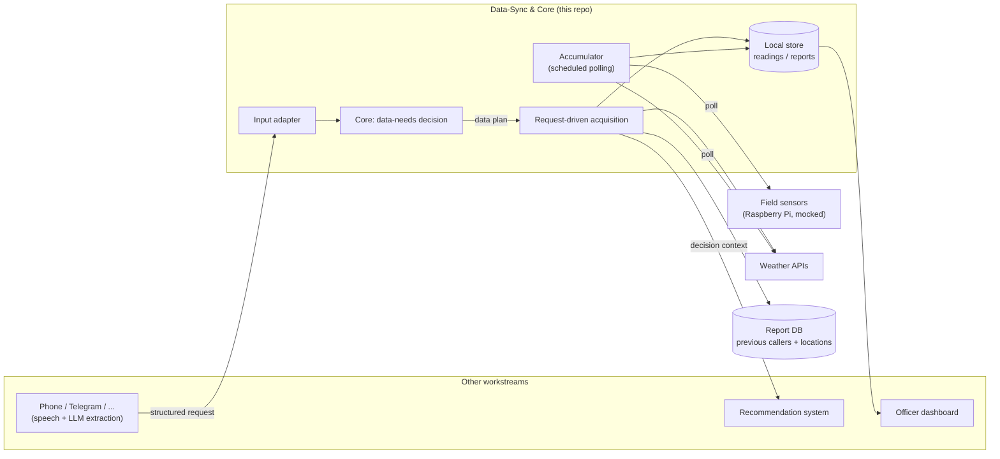
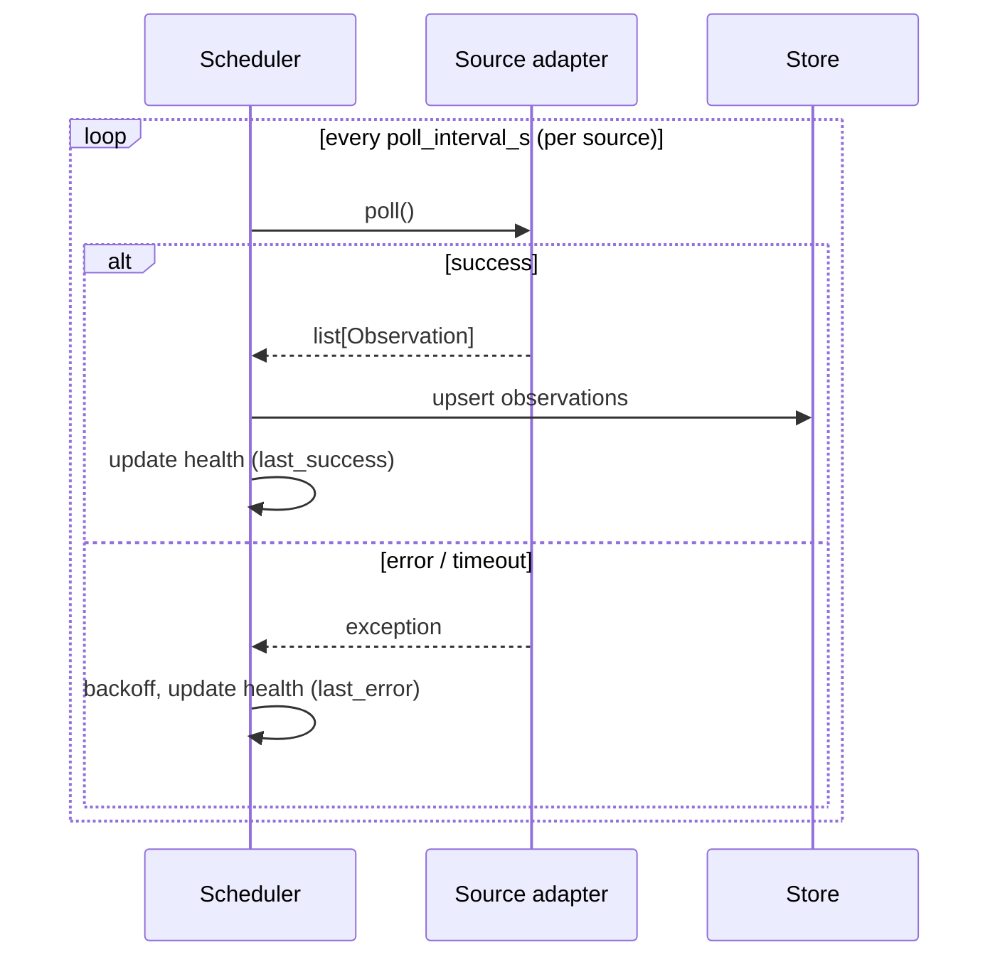
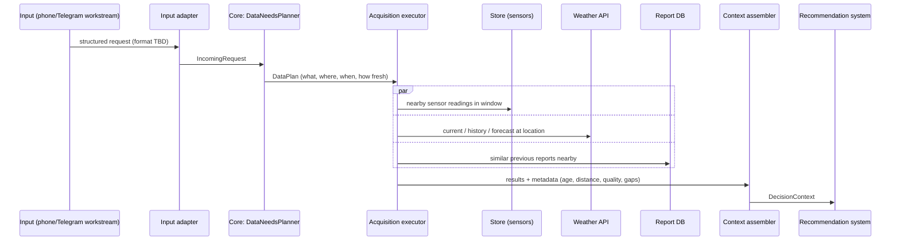

# Data-Sync & Core — Subsystem Specification

> **Status:** Draft / living document · **Owner:** Data-Sync & Core workstream · **Last updated:** 2026-10-16

---

## 0. About the documents in this repository

| File | Scope | Audience |
|---|---|---|
| [`project_overview.md`](project_overview.md) | The **whole hackathon project**: the *Farmer Advisory & Early-Warning System*. It describes the end-to-end concept (farmer calls → transcription → structured report → context → recommendation → spoken answer + officer dashboard), the overall architecture, the team split and the shared API contracts. It is the shared reference for **all** workstreams. | Whole team |
| [`project.md`](project.md) (this file) | The **Data-Sync & Core subsystem only** — the part of the system that continuously accumulates data from field sensors and external APIs, receives structured requests, decides *which* data is relevant for a request, and assembles it into a *decision context* for the recommendation system. It refines sections **3.B–3.D** of the overview and roughly covers the ownership of persons 3 and 4 in the team table. | Developers of this subsystem and the teams that integrate with it |

Rule of thumb: if something concerns *how the parts fit together*, it belongs in `project_overview.md`. If it concerns *how this subsystem works internally or what its interfaces look like*, it belongs here. When the two disagree, the overview wins for cross-team contracts and this file should be updated.

---

## 1. Purpose and scope

The Data-Sync & Core subsystem has three jobs:

1. **Data accumulation (sync)** — Periodically poll a set of *modular* data sources (field sensors such as rain gauges on Raspberry Pis, weather APIs, …), normalise their output and persist it, so that recent measurements are always available locally — even if a source is temporarily unreachable.
2. **Request-driven data acquisition** — When a structured request arrives (originating from a phone call, Telegram message, etc.), pull exactly the information relevant to *that* request: current/forecast weather for the location, stored sensor readings nearby, and previous reports from other callers in the area.
3. **The core (decision) layer** — Decide **what data is needed** for the recommendation system for a given request, orchestrate its acquisition, and hand over a structured, evidence-rich **decision context**.

### 1.1 In scope

- Pluggable source adapters + polling scheduler (the *accumulator*).
- Mock implementations of field sensors (real Raspberry Pi integration later).
- Weather API adapter(s) (Open-Meteo as default).
- Access layer for the report database (previous caller inputs and their locations).
- An input adapter that accepts the structured request in whatever shape is eventually agreed.
- The data-needs decision core and the decision-context output format.

### 1.2 Out of scope

- Telephony, speech-to-text, text-to-speech, Telegram bots — handled by another workstream. **We simply receive the structured request.**
- The LLM-based extraction that turns a transcript into the structured request.
- The recommendation logic itself (risk rules, advice wording) — we *feed* it.
- The officer dashboard (we may expose data it reads, but don't build it).

---

## 2. Position in the overall system



The subsystem has two "clocks":

- **Time-driven** (accumulator): runs continuously in the background, independent of any request.
- **Event-driven** (core + acquisition): runs once per incoming request.

---

## 3. Architecture

### 3.1 Components

| Component | Responsibility |
|---|---|
| **Source adapters** | One adapter per data source. Each knows how to fetch from its source and convert results into the common `Observation` format. Adapters are interchangeable (mock ↔ real). |
| **Source registry** | Holds all configured adapters, keyed by id. New sources are added via configuration, not by changing the core. |
| **Accumulator / scheduler** | Polls each registered *pollable* source at its own interval, handles retries/backoff, writes results to the store, tracks source health. |
| **Store** | Persistence for normalised observations (and access to the report DB). Answers spatial/temporal queries ("readings within 5 km over the last 72 h"). |
| **Input adapter** | Converts the incoming request (format TBD) into the internal `IncomingRequest` model. Swappable per channel/format version. |
| **Core — data-needs planner** | Given an `IncomingRequest`, decides which data is required → produces a `DataPlan`. **Decision logic is not defined yet** (see §6.3). |
| **Acquisition executor** | Executes a `DataPlan`: queries the store, calls live APIs where fresh data is required, queries the report DB, collects results + metadata (age, distance, quality, source). |
| **Context assembler** | Builds the final `DecisionContext` handed to the recommendation system, including evidence, uncertainty and gaps. |

### 3.2 Proposed directory layout

```text
data_core/
├── project_overview.md          # whole-project overview (shared)
├── project.md                   # this file
├── README.md
├── pyproject.toml
├── config/
│   ├── sources.yaml             # which sources exist, intervals, mock/real
│   └── planner.yaml             # planner strategy + parameters (radii, windows…)
├── src/data_core/
│   ├── models/                  # pydantic models: Observation, IncomingRequest, DataPlan, DecisionContext
│   ├── sources/
│   │   ├── base.py              # DataSource protocol
│   │   ├── registry.py
│   │   ├── sensors/
│   │   │   ├── rain_mock.py     # mocked Raspberry-Pi rain sensor
│   │   │   └── rain_rpi.py      # real implementation (later)
│   │   ├── weather/
│   │   │   └── open_meteo.py
│   │   └── reports/
│   │       └── report_db.py     # previous caller inputs + locations
│   ├── accumulator/
│   │   └── scheduler.py         # polling loop, backoff, health
│   ├── store/
│   │   ├── repository.py        # spatial/temporal queries
│   │   └── schema.sql
│   ├── input/
│   │   ├── base.py              # InputAdapter protocol
│   │   └── v0_generic.py        # tolerant adapter for the not-yet-final format
│   ├── core/
│   │   ├── planner.py           # DataNeedsPlanner protocol + strategies
│   │   ├── executor.py          # executes a DataPlan
│   │   └── context.py           # builds DecisionContext
│   └── api/
│       └── app.py               # FastAPI endpoints
└── tests/
    ├── fixtures/                # sample requests, sensor payloads, weather responses
    └── ...
```

Tech stack is aligned with the overview: **Python + FastAPI**, **pydantic** models, SQL (SQLite locally, Azure SQL in deployment), **Open-Meteo** for weather, `httpx` for HTTP, `APScheduler` or a plain `asyncio` loop for polling.

---

## 4. Data sources (modular)

### 4.1 The source contract

Every source implements the same small interface so that the accumulator and the core never depend on concrete sources:

```python
class DataSource(Protocol):
    id: str                      # e.g. "rain_sensor_field_01", "open_meteo"
    kind: SourceKind             # SENSOR | WEATHER | REPORTS | ...
    pollable: bool               # True → accumulator polls it periodically
    poll_interval_s: int | None

    async def poll(self) -> list[Observation]:
        """Fetch the latest data (used by the accumulator)."""

    async def query(self, q: SourceQuery) -> list[Observation]:
        """On-demand fetch for a location/time window (used by the core)."""

    async def health(self) -> SourceHealth:
        """Reachability, last success, last error."""
```

All sources emit the same normalised record:

```python
class Observation(BaseModel):
    source_id: str
    kind: SourceKind
    metric: str                  # "rainfall_mm", "temperature_c", "soil_moisture_pct", ...
    value: float | str
    unit: str | None
    observed_at: datetime        # when it was measured (UTC)
    ingested_at: datetime        # when we stored it
    latitude: float | None
    longitude: float | None
    quality: Quality             # OK | SUSPECT | MOCKED | STALE
    raw: dict | None             # original payload for traceability
```

Adding a new source = writing one adapter + one entry in `config/sources.yaml`. Nothing in the core changes.

### 4.2 Planned sources

| Source | Kind | Mode | Status | Notes |
|---|---|---|---|---|
| Rain sensor (Raspberry Pi) | SENSOR | polled | **mocked** | Mock generates plausible rainfall series per sensor location; real version will read from the Pi (HTTP/MQTT — TBD). Mocked data is flagged `quality=MOCKED`. |
| Further field sensors (soil moisture, temperature, turbidity, …) | SENSOR | polled | planned | Same contract; added when hardware/mocks exist. |
| Open-Meteo | WEATHER | polled + on-demand | planned | Polled for a fixed set of points of interest (sensor sites, villages); queried on-demand for arbitrary request locations (current, recent history, forecast). |
| Additional weather API | WEATHER | on-demand | optional | Fallback / cross-check. |
| Report DB (previous callers) | REPORTS | on-demand | planned | The maintained database of all previous inputs from callers incl. location, time, problem type. Owned jointly with the SQL workstream. |

### 4.3 Example config

```yaml
# config/sources.yaml
sources:
  - id: rain_sensor_field_01
    type: rain_mock            # swap to rain_rpi when hardware is ready
    location: { lat: -1.2921, lon: 36.8219 }
    poll_interval_s: 60
  - id: open_meteo
    type: open_meteo
    poll_interval_s: 900
    poll_points:
      - { name: demo_village, lat: -1.29, lon: 36.82 }
  - id: report_db
    type: report_db
    dsn: ${REPORT_DB_DSN}
```

---

## 5. The accumulator (scheduled polling)

- Runs as a background task inside the FastAPI app (one process for the hackathon, as recommended in the overview).
- Each pollable source has its **own interval**; a slow or failing source must never block the others.
- On failure: exponential backoff, record the error in `SourceHealth`, keep serving the last known data (marked `STALE` once it exceeds a configurable max age).
- **Idempotent writes**: `(source_id, metric, observed_at, lat, lon)` is unique, so re-polling doesn't create duplicates.
- Exposes health/freshness so the core can tell the recommendation system "sensor data is 3 h old" rather than silently using it.



---

## 6. Request-driven acquisition and the core

### 6.1 Incoming request (format not final)

The request reaches us **already structured**, but containing natural-language content (e.g. extracted from a phone call or a Telegram message by another workstream). **The exact layout will be decided later**, so the subsystem must be tolerant and adjustable:

- An `InputAdapter` per format/version maps the raw payload to the internal `IncomingRequest`.
- Unknown fields are preserved in `extra`, not rejected.
- Missing fields (e.g. no coordinates) are allowed and reported as gaps rather than causing errors.

Current working model (subject to change):

```python
class IncomingRequest(BaseModel):
    request_id: str
    channel: str                    # "phone_call", "telegram", ...
    received_at: datetime
    caller_id: str | None           # pseudonymous
    text: str                       # natural-language description / summary
    problem_type: str | None        # e.g. "crop_health", "flooding", "water_quality"
    symptoms: list[str] = []
    location: Location | None       # lat/lon and/or village name + precision
    reported_event_time: datetime | None
    extra: dict = {}                # anything not (yet) mapped
```

Example (aligned with the overview's example report):

```json
{
  "request_id": "r-2026-10-16-0001",
  "channel": "phone_call",
  "received_at": "2026-10-16T14:30:00Z",
  "text": "My crops have started dying since the heavy rains.",
  "problem_type": "crop_health",
  "symptoms": ["wilting", "yellow leaves"],
  "location": { "lat": -1.2921, "lon": 36.8219, "precision_m": 2000, "village": null }
}
```

### 6.2 Request flow



### 6.3 The core: deciding which data is needed

> ⚠️ **Open design question — not yet decided.**
> **How exactly the core determines which data is needed for the recommendation system is currently still unknown.** The final logic depends on what the recommendation system needs, which is not specified yet. This section therefore defines only the *interface* and possible strategies; the actual decision rules will be filled in once the requirements are known.

What is fixed is the **contract**: the planner takes a request and returns a declarative plan. Everything else — rules, LLM, learned model, or a mix — is an interchangeable strategy behind this interface.

```python
class DataNeed(BaseModel):
    source_kind: SourceKind          # SENSOR | WEATHER | REPORTS
    metrics: list[str] | None        # e.g. ["rainfall_mm"]; None = all
    radius_km: float | None
    time_window: TimeWindow          # e.g. last 72 h, next 48 h (forecast)
    max_age_s: int | None            # freshness requirement → forces live fetch if exceeded
    filters: dict = {}               # e.g. {"problem_type": "crop_health"}
    priority: Literal["required", "optional"]
    reason: str                      # why this data is requested (traceability)

class DataPlan(BaseModel):
    request_id: str
    needs: list[DataNeed]
    strategy: str                    # which planner produced it
    notes: list[str] = []

class DataNeedsPlanner(Protocol):
    def plan(self, request: IncomingRequest) -> DataPlan: ...
```

**Candidate strategies (none chosen yet):**

| Strategy | Idea | Pros | Cons |
|---|---|---|---|
| `fetch_all` (baseline / MVP fallback) | Always fetch everything within a default radius and time window. | Trivial, robust, good for demo and for testing the pipeline end-to-end. | Noisy context, wasteful, no relevance filtering. |
| `rule_based` | Mapping table `problem_type` → needed metrics/radius/window (e.g. *flooding* → rainfall last 72 h + forecast; *crop_health* → rainfall + temperature + similar reports within 5 km). | Transparent, explainable, matches the overview's demand for transparent rules. | Needs domain knowledge; brittle for unknown problem types. |
| `llm_assisted` | An LLM reads the request and chooses from a **fixed catalogue** of available data needs. | Handles free-text and unforeseen cases. | Less deterministic; must be constrained to the catalogue, never invent sources. |
| `hybrid` | Rules first, LLM only for unknown/ambiguous requests; always add a minimum baseline. | Best of both. | More moving parts. |

**Plan for now:** implement the interface + `fetch_all` so the whole pipeline works end-to-end; keep the strategy selectable via `config/planner.yaml`; replace/extend once the recommendation team defines its inputs.

### 6.4 Output: the decision context

The output handed to the recommendation system. It must make **evidence, freshness and uncertainty explicit**, consistent with the overview's requirement to separate suspected risk from confirmed diagnosis.

```json
{
  "request_id": "r-2026-10-16-0001",
  "generated_at": "2026-10-16T14:30:04Z",
  "request": { "problem_type": "crop_health", "text": "My crops have started dying since the heavy rains.", "location": { "lat": -1.2921, "lon": 36.8219, "precision_m": 2000 } },
  "plan": { "strategy": "fetch_all", "needs": ["..."] },
  "evidence": {
    "weather": {
      "source": "open_meteo",
      "rainfall_mm_last_72h": 84.2,
      "forecast_rainfall_mm_next_48h": 12.0,
      "fetched_at": "2026-10-16T14:30:02Z"
    },
    "sensors": [
      { "source_id": "rain_sensor_field_01", "metric": "rainfall_mm", "value_last_72h": 91.0, "distance_km": 1.4, "age_s": 60, "quality": "MOCKED" }
    ],
    "similar_reports": {
      "count": 6, "radius_km": 5, "window_h": 72,
      "items": [ { "report_id": "...", "problem_type": "crop_health", "distance_km": 2.1, "reported_at": "2026-10-15T09:12:00Z" } ]
    }
  },
  "gaps": [ "No soil-moisture sensor within 10 km" ],
  "warnings": [ "Sensor data is mocked" ]
}
```

---

## 7. API surface (proposed)

Aligned with the MVP contracts in `project_overview.md` §7; endpoints owned by this subsystem:

| Endpoint | Purpose |
|---|---|
| `POST /requests` | Receive a structured request; returns `request_id`. Optionally runs the pipeline synchronously. |
| `GET /context/{request_id}` | Return the assembled `DecisionContext` (matches overview's `GET /context/{report_id}`). |
| `GET /plan/{request_id}` | Inspect the `DataPlan` the core produced (debugging / explainability). |
| `GET /observations?lat=&lon=&radius_km=&since=&metric=` | Query accumulated sensor/weather observations (also usable by the dashboard). |
| `GET /sources` | List registered sources with health and data freshness. |
| `POST /sources/{id}/poll` | Trigger an immediate poll (demo / debugging). |

---

## 8. Storage

Builds on the tables proposed in the overview (`sensor_readings`, `weather_observations`, `farmer_reports`). For flexibility we suggest a single generic observations table plus the report table owned by the SQL workstream:

| Table | Key fields | Owner |
|---|---|---|
| `observations` | `id`, `source_id`, `kind`, `metric`, `value`, `unit`, `observed_at`, `ingested_at`, `latitude`, `longitude`, `quality`, `raw_json` | this subsystem |
| `source_health` | `source_id`, `last_success_at`, `last_error_at`, `last_error`, `consecutive_failures` | this subsystem |
| `requests` / `farmer_reports` | previous caller inputs incl. location — see overview | shared with SQL workstream |
| `decision_contexts` | `request_id`, `plan_json`, `context_json`, `created_at` | this subsystem (audit trail for the dashboard) |

Spatial queries use a bounding-box prefilter + Haversine distance in Python for the MVP; PostGIS / spatial indexes only if needed.

---

## 9. Non-functional requirements

- **Modularity:** sources, input formats and planner strategies are all swappable via config.
- **Resilience:** any single source failing degrades the context (listed under `gaps`/`warnings`) but never breaks the pipeline.
- **Traceability:** every value in the context carries its source, timestamp, distance and quality; the plan records *why* each need was requested.
- **Honesty about data:** mocked data is always labelled; stale data is labelled; sensors are indicators, not proof (see overview §3.D).
- **Latency:** context should be ready within a few seconds so the caller can get an answer during the call; prefer accumulated data and only fetch live where freshness requires it.
- **Privacy:** callers are referenced by pseudonymous id; store location at the precision needed, no more.
- **Testability:** every source has a mock; fixtures for requests and API responses allow running the full pipeline offline.

---

## 10. Open questions / decisions pending

| # | Question | Depends on | Status |
|---|---|---|---|
| 1 | **How does the core decide which data is needed?** (strategy, rules, inputs required by the recommendation system) | Recommendation workstream | **Open — still unknown** |
| 2 | Final layout of the incoming structured request (fields, versions, channels) | Phone/Telegram + extraction workstream | Open |
| 3 | How the Raspberry Pi delivers sensor data (HTTP pull, MQTT push, file sync) | Hardware | Open — mocked meanwhile |
| 4 | Which sensors beyond rain are available | Hardware | Open |
| 5 | Exact schema / ownership of the report DB | SQL workstream | Open |
| 6 | Default radii and time windows (e.g. 5 km / 72 h) | Domain input | Provisional values in config |
| 7 | Should the pipeline run synchronously on `POST /requests` or asynchronously with a callback? | Integration workstream | Open |

---

## 11. Implementation roadmap

| Phase | Deliverable |
|---|---|
| **1. Skeleton** | Repo layout, pydantic models, FastAPI app, config loading, fixtures. |
| **2. Sources** | `DataSource` protocol, registry, mocked rain sensor, Open-Meteo adapter, report-DB adapter (against SQLite fixture). |
| **3. Accumulator** | Scheduler with per-source intervals, backoff, upserts, health tracking, `/sources` endpoint. |
| **4. Input** | `InputAdapter` protocol + tolerant v0 adapter, `POST /requests`. |
| **5. Core (MVP)** | `DataNeedsPlanner` interface + `fetch_all` strategy, executor, context assembler, `GET /context/{id}`. |
| **6. Integration** | Agree payloads with recommendation + input teams, end-to-end run of the overview's demo scenario. |
| **7. Core (real)** | Replace/extend `fetch_all` with the chosen strategy once §6.3 is decided. |
| **8. Hardware** | Swap mocked rain sensor for the Raspberry-Pi implementation. |

---

## 12. Glossary

| Term | Meaning |
|---|---|
| **Accumulator** | Background component that periodically polls sources and stores their data. |
| **Source adapter** | Plug-in that fetches data from one source and normalises it to `Observation`s. |
| **Incoming request** | The structured (natural-language-containing) input derived from a phone call, Telegram message, etc. |
| **Data plan** | The core's declarative statement of what data a given request needs. |
| **Decision context** | The assembled evidence package handed to the recommendation system. |
| **Gap** | Data that was wanted but not available (no sensor nearby, API down, no location). |
